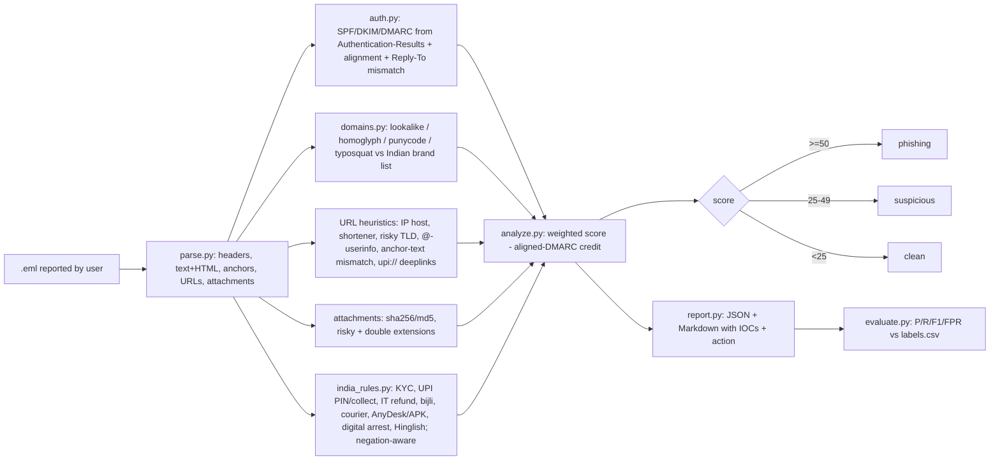

# PhishDesk-IN — explainable `.eml` phishing analyser with Indian bank/UPI lure rules

> **Lab project.** All 69 emails in `data/samples/` are **synthetic lab data** made by `data/generate_dataset.py`. Every message has the header `X-Lab-Data: synthetic`. Attacker domains are made-up lookalikes, IPs come from RFC 5737 documentation ranges, and the people are invented. Lure wording is paraphrased from public advisories (see Sources). Related work: [ahmedbahroun06/PhishLens](https://github.com/ahmedbahroun06/PhishLens).

## Problem
In Indian SOCs and helpdesks, most user-reported phishing is a handful of local lures: "KYC pending, account will be blocked", "approve this UPI collect request to receive cashback", income-tax refunds, electricity disconnection, India Post redelivery fees and "digital arrest". Generic analysers check SPF/DKIM but don't know that `sbl-netbanking.online` imitates SBI, or that nobody needs a UPI PIN to *receive* money. PhishDesk-IN takes a reported `.eml` and returns a **verdict (phishing / suspicious / clean), a 0–100 score and the list of rules that fired**, as both JSON (for SOAR/ticketing) and Markdown (for the analyst).

## Architecture


## Layout
| Path | What |
|---|---|
| `phishdesk/parse.py` | stdlib `email` parser. Never executes or renders content; attachments are only hashed |
| `phishdesk/auth.py` | SPF/DKIM/DMARC results (RFC 8601) and relaxed alignment (RFC 7489) |
| `phishdesk/domains.py` | registrable domain (with `.co.in`/`.gov.in`), Levenshtein typosquats, homoglyphs (`0→o`, `rn→m`), punycode, URL rules |
| `phishdesk/india_rules.py` | 12 India-specific lure rules plus UPI VPA detection, with negation handling ("never share your OTP" is advice, not a lure) |
| `phishdesk/analyze.py` | scoring and verdict |
| `phishdesk/report.py`, `cli.py` | Markdown/JSON reports |
| `phishdesk/evaluate.py` | metrics against labels |
| `data/samples/*.eml`, `data/labels.csv` | 69 labelled lab emails (36 phishing / 33 legit, 18 categories, 9 deliberately hard cases) |
| `results/` | real outputs from my run: `eval.json`, `eval_strict.json`, `run.log`, `reports/*.json|md` (69 each) |
| `tests/` | pytest (8 tests) |

## Run
```bash
python3 -m venv .venv && .venv/bin/pip install -r requirements-dev.txt   # zero runtime deps (stdlib only)
.venv/bin/pytest -q
python3 data/generate_dataset.py                       # rebuild the lab corpus (seeded, byte-identical)
python3 -m phishdesk.cli path/to/reported.eml -o out/  # one mail -> out/<name>.json + .md
python3 -m phishdesk.cli data/samples -o results/reports
python3 -m phishdesk.evaluate            # phishing+suspicious counted as positive
python3 -m phishdesk.evaluate --strict   # only 'phishing' counted as positive
docker build -t phishdesk-in . && docker run --rm -v "$PWD/inbox:/mail:ro" phishdesk-in /mail
```

## Results (actual run on the box, 2026-10-11, Python 3.13, CPU only)
n = 69 (36 phishing / 33 legit). Positive class = phishing. Analysing all 69 mails took about 0.1 s.

| Mode | TP | FP | TN | FN | Precision | Recall | F1 | FPR | Accuracy |
|---|---|---|---|---|---|---|---|---|---|
| phishing+suspicious = positive | 30 | 3 | 30 | 6 | **0.909** | **0.833** | **0.870** | 0.091 | 0.870 |
| strict (phishing only) | 30 | 3 | 30 | 6 | 0.909 | 0.833 | 0.870 | 0.091 | 0.870 |

The two modes match because, on this corpus, no mail landed in the 25–49 "suspicious" band. Scores cluster near 0 or near 100.

**All 9 errors are in the categories I built to be hard:**
- **4 FN: compromised legitimate accounts (BEC-style).** SPF, DKIM and DMARC all pass and are aligned, and the lure is a generic English "shared document" with a bit.ly link. The only signal is the shortener, and the aligned-DMARC credit cancels it out (score 0). Header and lexical rules can't catch a real account sending a bad link. That takes URL detonation or sender-behaviour baselining.
- **2 FN: quishing.** The URL sits inside a QR-code PNG and I don't decode images.
- **3 FP: mailing-list forwarding.** The list rewrites the message, so SPF, DKIM and DMARC all fail (score 55) even though the mail is legitimate. Handling ARC (RFC 8617) would fix this.

Every other category scored 100%. That figure is optimistic: I wrote both the lab mails and the rules, so treat it as a regression suite, not a real-world detection rate.

Example report: [`results/reports/001_kyc.md`](results/reports/001_kyc.md). It shows lookalike `sbi-kyc-update.top`, anchor text `www.onlinesbi.sbi` pointing elsewhere, DMARC fail, the KYC-block lure and Hinglish urgency, for a score of 100.

## Limitations
- **Synthetic, self-labelled corpus** with one labeller and 69 mails. Next step: evaluate on real public corpora (Nazario phishing corpus, SpamAssassin ham) and real CERT-In samples.
- **Trusts the receiving MTA's `Authentication-Results`.** It doesn't re-verify DKIM cryptographically or query DNS for SPF/DMARC (lab mail has no live DNS). Attackers can forge that header if your gateway doesn't strip inbound copies.
- **No live reputation or detonation.** Reputation is offline heuristics only: TLD, shortener, lookalike. The hooks for urlscan.io, VirusTotal (by sha256) and PhishTank are not implemented, so that isn't claimed.
- Small hard-coded public-suffix subset instead of the full PSL. The brand list holds 18 Indian brands.
- No OCR/QR decoding and no ARC handling (see errors above). The regex lures are English and Hinglish only; there are no Devanagari rules yet.
- Weights were hand-tuned on the same corpus they're evaluated on (no held-out split).
- `Dockerfile` written but not built on the box (no Docker daemon there). CI workflow written but not run on GitHub (not pushed).

## Sources
- RFC 7208 (SPF), RFC 6376 (DKIM), RFC 7489 (DMARC), RFC 8601 (Authentication-Results), RFC 8617 (ARC), RFC 5737 (doc IPs), RFC 2606 (`.example`)
- RBI, *BE(A)WARE: a booklet on modus operandi of financial frauds*: https://rbi.org.in/commonman/Upload/English/Content/PDFs/BEAWARE07032022.pdf
- CERT-In advisories (phishing / smishing campaigns): https://www.cert-in.org.in
- NPCI UPI safety awareness ("PIN is not needed to receive money"): https://www.npci.org.in/what-we-do/upi/upi-safety-awareness
- I4C / National Cybercrime Reporting Portal (digital-arrest and electricity-bill advisories): https://cybercrime.gov.in
- Unicode TR #39 confusables (homoglyph idea): https://www.unicode.org/reports/tr39/
- Inspiration: https://github.com/ahmedbahroun06/PhishLens
